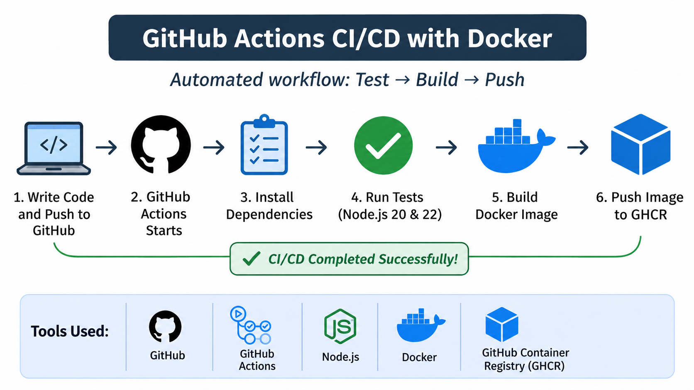
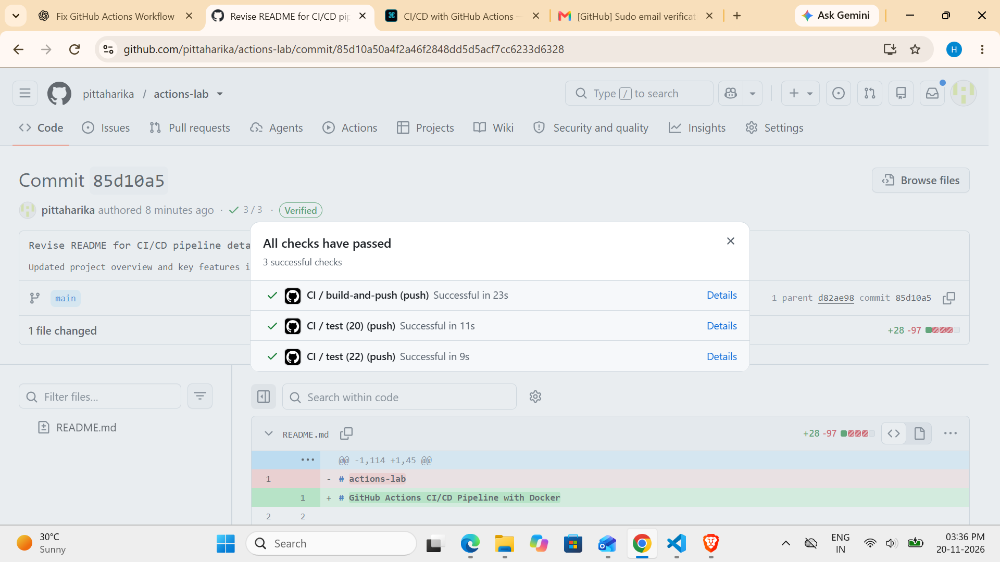

# Automated CI/CD Pipeline with GitHub Actions and Docker

## Project Overview

This project demonstrates the implementation of an automated CI/CD pipeline using GitHub Actions, Node.js, Docker, and GitHub Container Registry (GHCR).

The pipeline automates the software delivery process, starting from code integration and automated testing to Docker image creation and container registry publishing.

The primary objective is to implement a reliable, repeatable, and maintainable delivery workflow that validates application changes before publishing a container image.

# Architecture
The CI/CD workflow follows a staged delivery approach:



## Technologies Used

- Git and GitHub
- GitHub Actions
- Node.js
- npm
- Docker
- GitHub Container Registry (GHCR)

## CI/CD Workflow

1. Developer pushes code to the main branch.
2. GitHub Actions automatically starts the workflow.
3. Automated tests run using Node.js 20 and 22.
4. Docker image is built.
5. Docker image is pushed to GitHub Container Registry.

## Key Features

- Automated testing
- Multi-version Node.js testing
- Docker image building
- Automated image publishing to GHCR
- GitHub Actions workflow automation



## Docker Image

`ghcr.io/pittaharika/actions-lab:latest`

## How to Run

```bash
docker pull ghcr.io/pittaharika/actions-lab:latest
docker run ghcr.io/pittaharika/actions-lab:latest
```

## Project Outcome

Successfully implemented and executed an automated CI/CD pipeline that validates application changes across multiple Node.js versions and publishes a Docker image to GitHub Container Registry after successful validation.

The project demonstrates practical understanding of the software delivery lifecycle and the integration of source control, automated testing, containerization, and container registry publishing.
